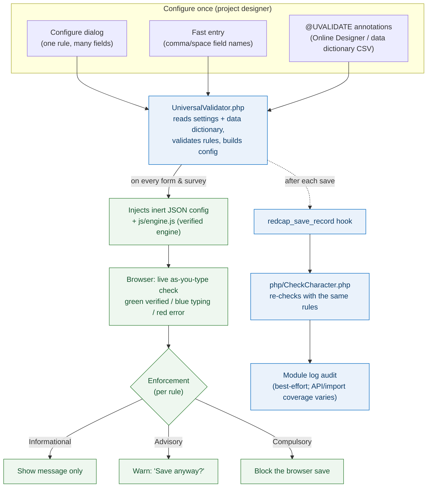

# Universal Field Validator — User & Training Guide

A hands-on guide to validating IDs, codes, and structured text in REDCap with the
**Universal Field Validator** external module (v0.8.0). It catches a mistyped
participant ID, a mis-scanned specimen barcode, or an off-format lab number while
the person who typed it is still looking at the field — before the bad value ever
reaches your dataset.

This guide is written as training content: each Part stands on its own and maps
to one slide group, so it doubles as the script for a presentation.

---

## Who this guide is for

| You are… | Read | Start at |
|---|---|---|
| A **REDCap administrator** installing the module on the server | Parts 1, 2, 7 | [Part 2](#part-2-install-and-enable-the-module) |
| A **project designer / data manager** writing validation rules | Parts 1, 3, 4, 6, 8 | [Part 3](#part-3-configure-validation-rules) |
| **Data-entry staff or a survey respondent** who just wants to know what the messages mean | Parts 1, 5 | [Part 5](#part-5-what-the-person-entering-data-sees) |

## Contents

- [Part 1: Core concepts](#part-1-core-concepts)
- [Part 2: Install and enable the module](#part-2-install-and-enable-the-module)
- [Part 3: Configure validation rules](#part-3-configure-validation-rules)
- [Part 4: Validation scenarios](#part-4-validation-scenarios)
- [Part 5: What the person entering data sees](#part-5-what-the-person-entering-data-sees)
- [Part 6: Format patterns and safety](#part-6-format-patterns-and-safety)
- [Part 7: Server-side audit and privacy](#part-7-server-side-audit-and-privacy)
- [Part 8: Troubleshooting and FAQ](#part-8-troubleshooting-and-faq)
- [Appendix A: Algorithm reference](#appendix-a-algorithm-reference)
- [Appendix B: Algorithm shorthands](#appendix-b-algorithm-shorthands)
- [Appendix C: Rule option reference](#appendix-c-rule-option-reference)
- [Appendix D: Safe vs risky patterns](#appendix-d-safe-vs-risky-patterns)
- [Appendix E: Copy-paste cheat sheet](#appendix-e-copy-paste-cheat-sheet)

---

## Part 1: Core concepts

### The problem it solves

REDCap's stock validation checks *shape* — is this a date, a number, an email?
It cannot tell that `TB-004821` was meant to be `TB-004822`, because both are
valid-looking text. In a multi-site study those single-character slips turn into
hours of reconciliation: specimens that cannot be matched to a participant,
duplicate records, lab results filed against the wrong ID.

This module adds two kinds of checking that stock REDCap does not:

1. **Check-character validation** — many IDs are minted with a trailing
   *check character* computed from the rest of the ID. Recomputing it catches
   almost every single-character typo and digit swap, including the ones a
   format check can never see (a `3` typed as an `8` keeps the same shape).
2. **Format (regex) validation set per rule** — a project designer defines the
   exact shape of a code (`FC` + four digits, a six-digit sequence, a year), and
   typists get progressive "what's still missing" guidance as they type. In
   stock REDCap a custom regex type has to be added server-wide by an admin; here
   it is a per-rule setting.

Both run live in the browser, and both are re-checked on the server after save.

### Vocabulary

- **Check character** — the last one or two characters of an ID, derived by an
  algorithm (ISO 7064, Damm, Verhoeff, Luhn, and the weighted schemes) from
  everything before it. Change any character and the check no longer matches.
- **Payload** — the part of the ID the algorithm runs its math over (see
  **source** below).
- **Normalize / strip** — before checking, the value is upper-cased, Unicode
  dashes are folded to `-`, and configured separators (dash, slash, space,
  underscore, pipe, backslash by default) are removed. So `tbabc 00239` and
  `TBABC-00239` are treated identically.
- **Single vs pooled field** — a *single* field holds one ID. A *pooled* field
  is one box holding several IDs (a tube rack scanned into one Notes field, say),
  which the module splits into members.
- **Enforcement mode** — per rule, what happens on an invalid value:
  *Informational* (message only), *Advisory* (ask before saving), or
  *Compulsory* (block the browser save). See [Part 3](#enforcement-modes).
- **Configuration channel** — the three interchangeable ways to attach a rule to
  fields: the Configure dialog, fast entry, and `@UVALIDATE` annotations.

### How it works

A REDCap administrator installs the module once. Each project enables it and adds
rules on its settings screen (or via field annotations). On every form and
survey, the module reads its rules, builds a configuration object, and injects
the verified engine (`js/engine.js`) that does the live checking. A separate
server hook re-checks each saved value as a best-effort audit.



### Where validation runs — and where it does not

| Path | Live check as you type | Can block the save | Logged by the audit |
|---|:---:|:---:|:---:|
| Data-entry **form** (browser) | ✅ | ✅ *Compulsory* | ✅ |
| **Survey** page (browser) | ✅ | ✅ *Compulsory* | ✅ |
| **API** write | ❌ | ❌ never | ⚠️ version-dependent |
| **Data Import Tool** | ❌ | ❌ never | ⚠️ version-dependent |

Two limits to keep in mind from the start:

- **Check-character and format rules attach to Text and Notes fields only.**
  Pointing a Single-value or Pooled rule at a dropdown, radio, date, or calc
  field produces a configuration error. The newer **Constraint** (`@UVASSERT`)
  and **Required** (`@UVREQUIRED`) rules are wider: they also accept dropdown,
  radio, yes/no, true/false and slider fields (constraints additionally accept
  calc; a Required rule rejects calc because the person entering data cannot
  fill one). See the README sections on those two tags.
- **The browser is the enforcement point.** *Compulsory* blocks a human form or
  survey save; it cannot stop an API or import write. The server audit is a
  detection log that fires *after* the write, and whether it covers API and Data
  Import Tool writes **depends on your REDCap version** — verify it on your own
  instance before relying on it (see [Part 7](#part-7-server-side-audit-and-privacy)).

---

## Part 2: Install and enable the module

*Audience: REDCap administrators and project administrators.*

### Requirements

- REDCap **13.7.0+**
- PHP **7.4.0+** with the `mbstring` and `ctype` extensions (both ship enabled in
  standard PHP builds; some minimal builds omit them)
- External Module Framework **v14** (declared in `config.json`)

### 1. Install on the server (administrator, once)

**From a downloaded copy**

1. Put the module folder under `redcap/modules/` named with its version, e.g.
   `redcap/modules/universal_validator_v0.8.0/`. The folder must contain
   `config.json` at its top level. (REDCap reads the version from the folder
   name — the module has no separate version field.)
2. Go to **Control Center → External Modules → Manage**. The module appears as
   available. Click **Enable**.

**From the REDCap repository** (once published): Control Center → External
Modules → **View modules available in the repository** → find *Universal Field
Validator* → **Download** → **Enable**.

### 2. Enable on a project (project administrator)

Project **External Modules** page → **Enable a module** → *Universal Field
Validator*.

### 3. Set the project-level privacy option

There is one project-level setting, **How to log invalid values caught by the
post-save audit**. It controls how the after-save audit stores the invalid value
and the record ID. Pick the mode your data-governance policy allows *before*
turning the module loose on real IDs — details in
[Part 7](#part-7-server-side-audit-and-privacy). The default (**hashed**) is a
safe starting point.

Then add rules ([Part 3](#part-3-configure-validation-rules)) and confirm it
works ([Part 4](#part-4-validation-scenarios)).

> The module injects its own JavaScript. The JavaScript Injector module is **not**
> required and should not also carry an ID-check script for the same fields.

---

## Part 3: Configure validation rules

*Audience: project designers and data managers. This is the core of the guide.*

**One rule = one kind of validation, applied to any number of fields.** A rule
says "these fields all hold IDs minted with ISO 7064 Mod 37,36" or "these fields
must match `FC[0-9]{4}`". Add one rule per *kind* of field, not one per field.

### The three configuration channels

All three produce the same internal rule and can be mixed freely across a project.

| Channel | Best when | Where |
|---|---|---|
| **Configure dialog** | You have a handful of rules and want a guided form | Project → External Modules → *Universal Field Validator* → **Configure** |
| **Fast entry** | One rule covers many fields and you know their names | The "Fast entry" box inside a dialog rule |
| **`@UVALIDATE` annotations** | Bulk setup — tagging many fields, or configuring as you design | The Online Designer's Action Tags box, or the `field_annotation` column of the data dictionary CSV |

A field claimed by **two** rules shows a configuration error rather than running
two conflicting validators. Give each field exactly one rule.

### Anatomy of a rule

Every rule is built from the same options, whichever channel you use. The dialog
uses hyphenated labels; the `@UVALIDATE` JSON uses camelCase keys. They map
one-to-one:

| Dialog field | JSON key | Applies to | Default | What it does |
|---|---|---|---|---|
| Field type | `type` | all | `single` | `single` (one ID per field) or `pooled` (several IDs in one box) |
| Field(s) / Fast entry | *(the field name)* | all | — | Which field(s) the rule validates |
| Check-character method | `algorithm` | all | `iso7064_mod37_36` | The check algorithm, or `none` for format-only. See [Appendix A](#appendix-a-algorithm-reference) |
| What the check runs over | `source` | all | `normalized_id` | `normalized_id` (whole ID), `digits_only`, or `sequence_only` (trailing number) |
| Optional format pattern | `pattern` | all | — | A regex the value must match. Required when `algorithm` is `none`. See [Part 6](#part-6-format-patterns-and-safety) |
| Separators to ignore | `strip` | all | dash, slash, space, underscore, pipe, backslash | Characters removed before checking |
| Extra characters to keep | `keepChars` | pooled | — | Rarely needed; keeps extra characters when splitting a pool |
| Exact ID length(s) | `idLengths` | pooled | — | e.g. `[9]` or `"10, 12"`; overrides the min/max range |
| Minimum ID length | `idMinLen` | pooled | `8` | Used only if exact lengths are blank |
| Maximum ID length | `idMaxLen` | pooled | `14` | Must be **less than 2× the minimum** |
| Expected number of IDs | `expectedIds` | pooled | — | Warns if the pool holds a different count |
| On an invalid value | `blockSave` | all | `off` | Enforcement: `off`, `confirm`, or `hard`. See below |
| Only validate when | `when` | all | — | A REDCap-style condition; the rule validates only while it is true. See [Scenario 9](#scenario-9-conditional-validation-with-the-when-key) |
| Rule label | `note` | all | — | Your own name for the rule (admin-facing only; never shown to typists) |

> **`note` is a label, not a message.** It helps you organize rules ("Specimen
> IDs", "Legacy screening codes"). It is not shown to the person entering data,
> and there is no per-rule custom error message — the module writes the wording
> itself so it can pinpoint *which* character is wrong (see
> [Part 5](#part-5-what-the-person-entering-data-sees)).

### Choosing an algorithm

Match the method to **how the IDs were minted**. If you do not know, ask whoever
generates them; the wrong algorithm flags every value as invalid.

| Your IDs are… | Use |
|---|---|
| Minted by the companion QR/ID generator (its default) | `iso7064_mod37_36` (the module default) — letters + digits |
| Digits only, need a strong check | `iso7064_mod11_10`, or `iso7064_mod97_10` for longer numbers |
| Letters only | `iso7064_letters1` / `iso7064_letters2` |
| GS1 / GTIN / EAN / UPC barcodes | `gs1_mod10` |
| US bank routing numbers | `aba_mod10` |
| ICAO passport MRZ (digit fields) | `mrz_mod10` |
| ISBN-10 (≤ 9-digit payloads) | `weighted_mod11` |
| A fixed shape but **no** check character | `none` + a `pattern` |

A note on strength, straight from the module's own docs: the three Mod-10
schemes (`gs1`, `aba`, `mrz`) catch every single-digit error at any length but
miss adjacent swaps of digits differing by 5. `weighted_mod11` (ISBN-10) is fully
strong **only up to 9 digits**; at 10+ digits one position goes blind to
substitutions, so prefer `iso7064_mod11_2` or `iso7064_mod97_10` for longer
numbers. Luhn is the weakest and is offered for compatibility only.

### The `source` modifier

`source` controls what the algorithm runs over:

- `normalized_id` (default) — the whole normalized ID.
- `digits_only` — only the digits. Use when a mixed ID's check protects just its
  numeric part. **Caveat:** letters are then ignored, so a letter typo will not be
  caught. Example: with `iso7064_mod11_10` + `digits_only`, `TBABC-00239` mints to
  `TBABC-002396` — but `TZABC002396` (a changed letter, dropped dash) also
  validates, because only the digits `00239` and the check `6` are examined.
- `sequence_only` — only the trailing number. Use when a running sequence at the
  end carries the check and the prefix is decorative.

<a id="enforcement-modes"></a>
### Enforcement modes

`blockSave` decides what happens when the value is invalid. **All three are
browser behaviors** — none can block an API or import write.

| Dialog label | `blockSave` | Behavior |
|---|---|---|
| Informational | `off` (default) | Show the message under the field; the save proceeds |
| Advisory | `confirm` | On save, a dialog asks to confirm before writing an invalid value |
| Compulsory | `hard` | Block the browser form/survey save until the value is fixed |

*Compulsory* never traps a **read-only** field — someone who cannot edit the
value is not blocked by it. That includes a `@READONLY` radio, yes/no or
autocomplete dropdown, and a field whose row branching logic or `@HIDDEN` hides. Start new rules at *Informational* to see what they
catch, then tighten to *Advisory* or *Compulsory* once you trust them.

### `@UVALIDATE` annotation syntax

Three forms, from simplest to fullest:

```text
@UVALIDATE                                            default check (ISO 7064 Mod 37,36), message only
@UVALIDATE=verhoeff                                   pick the algorithm by name (or a shorthand)
@UVALIDATE={"algorithm":"none","pattern":"FC[0-9]{4}","blockSave":"hard"}   full rule as JSON
```

Rules for the annotation form:

- Use **double quotes** inside the JSON. Single-quoted JSON is rejected.
- `algorithm` accepts case-insensitive **shorthands** (`3736`, `9710`, `mod10`,
  `gs1`, `isbn`, `regex`, …) — see [Appendix B](#appendix-b-algorithm-shorthands).
- **Fields with identical tags are grouped into one rule** automatically. Tag 50
  specimen fields with the same `@UVALIDATE=...` and they become one rule.
- A malformed tag (typo'd key, unknown algorithm, bad JSON, or a tag on a
  non-Text/Notes field) shows a configuration error — never a silent no-op.
- **Bulk setup:** put the tag in the `field_annotation` column of the data
  dictionary CSV, fill it down for every field you want, and upload the
  dictionary once.

> **Save-time safety:** whichever channel you use, an invalid rule (unknown
> algorithm, non-compiling or catastrophic regex, unsafe pooled lengths,
> unsupported field type) is rejected **when you press Save in the Configure
> dialog**, with a message naming the rule. A bad rule never reaches data-entry
> staff silently.

---

## Part 4: Validation scenarios

*Audience: project designers. Every value below is a real pass/fail case from the
module's own test fixtures.* Each scenario shows the rule **both** as dialog
settings and as a `@UVALIDATE` annotation.

### Scenario 1: Participant ID with a check character (the flagship)

**Goal.** Participant IDs are minted with the default ISO 7064 Mod 37,36 check.
Catch mis-keyed IDs at entry.

**Rule.**

- *Dialog:* Field type **Single**, Check-character method **ISO 7064 Mod 37,36
  (default)**, On an invalid value **Advisory**.
- *Annotation:* `@UVALIDATE={"blockSave":"confirm"}` (or bare `@UVALIDATE` for
  message-only).

**Try it.**

| Value | Result | Why |
|---|---|---|
| `0ABC00001W` | ✅ verified | `W` is the correct check character for `0ABC00001` |
| `0ABC00001X` | ❌ invalid | `X` does not match — a typo in the check or the body |

**What the typist sees.** Green *"✓ ID verified — the check character matches."*
for the first; red *"✗ This ID's check character does not match — probably a typo
or mis-scan…"* for the second, plus a conditional hint about what the last
character should be if the rest is right.

### Scenario 2: Specimen code with a strict format and no check character

**Goal.** Specimen labels are `FC` followed by exactly four digits. There is no
check character — enforce the shape and hard-block bad ones.

**Rule.**

- *Dialog:* Field type **Single**, Check-character method **No check character**,
  Format pattern `FC[0-9]{4}`, On an invalid value **Compulsory**.
- *Annotation:* `@UVALIDATE={"algorithm":"none","pattern":"FC[0-9]{4}","blockSave":"hard"}`

**Try it.**

| Value | Result | Why |
|---|---|---|
| `FC0001` | ✅ format OK | Matches `FC` + 4 digits |
| `FC001` | ❌ incomplete | Only three digits |
| `FCABCD` | ❌ format error | Letters where digits are required |

**What the typist sees.** While typing `FC00`, blue *"… format OK so far —
remaining: 2 × digit."* On `FCA`, red *"✗ FORMAT error at character 3: expected
digit, got A."* On `FC0001`, green *"✓ ID format OK. (This project's IDs carry no
check character, so typos that keep the format cannot be detected.)"* On a
*Compulsory* rule, an incomplete value blocks the save until fixed.

### Scenario 3: Site-prefixed IDs with separators

**Goal.** IDs look like `TBABC-00239` with a dash, and carry the default check.
You do **not** want the dash to interfere with checking.

**Rule.** Same as Scenario 1 — no extra work. The default `strip` already removes
dashes, slashes, spaces, underscores, pipes, and backslashes before checking.

- *Annotation:* bare `@UVALIDATE`.

**Try it.** `TBABC-00239` mints to `TBABC-002397`; entering `TBABC-002397`
validates ✅ (the dash is stripped, then `TBABC00239` + check `7` is verified).
`tbabc 00239` normalizes the same way. Only change `strip` if your IDs use an
unusual separator that must be ignored.

### Scenario 4: Guard only the numeric part of a mixed ID

**Goal.** A mixed ID whose *digits* carry the check, using `source: digits_only`.

**Rule.**

- *Dialog:* Field type **Single**, Check-character method **ISO 7064 Mod 11,10**,
  What the check runs over **Digits only**.
- *Annotation:* `@UVALIDATE={"algorithm":"mod11_10","source":"digits_only"}`

**Try it.** `TBABC-00239` mints to `TBABC-002396`, which validates ✅.

**Read the caveat.** `TZABC002396` **also** validates ✅ — only the digits `00239`
and the check `6` are examined, so the letter change from `TBABC` to `TZABC` is
invisible to this rule. Use `digits_only` only when the numeric part is what you
actually need to protect; otherwise keep the default whole-ID check.

### Scenario 5: A pooled specimen field (several IDs in one box)

**Goal.** A tube rack is scanned into one Notes field. Each specimen ID is 9
characters with the default check. You expect 3 per pool.

**Rule.**

- *Dialog:* Field type **Pooled**, Check-character method **ISO 7064 Mod 37,36**,
  Exact ID length(s) `9`, Expected number of IDs `3`.
- *Annotation:* `@UVALIDATE={"type":"pooled","idLengths":[9],"expectedIds":3}`

**Try it.**

| Value in the box | Result |
|---|---|
| `0ABC0000H0ABC0001F0DEF00093` | ✅ 3 IDs, all verified |
| `0ABC0000H, 0ABC0001F 0DEF00093` | ✅ same 3 IDs (separators optional) |
| `0ABC0000H0ABC0001FZZ` | ⚠️ 2 IDs + leftover junk `ZZ` |
| `0ABC0000H0ABC0001F0ABC0000H` | ⚠️ 3 IDs, the last a duplicate of the first |
| `0DEF00093` alone | ⚠️ 1 ID read but 3 expected |

**What the typist sees.** One chip per member: green ✓ for verified, red ✗ for a
bad check, red ⊗ "(again!)" for a duplicate, amber ? for junk — with a one-line
summary like *"2 IDs read — leftover text that is not an ID"*.

### Scenario 6: A pooled field of format-only codes

**Goal.** A field holds several `FC` + 4-digit codes with no check character.

**Rule.**

- *Dialog:* Field type **Pooled**, Check-character method **No check character**,
  Format pattern `FC[0-9]{4}`, Exact ID length(s) `6`.
- *Annotation:* `@UVALIDATE={"type":"pooled","algorithm":"none","pattern":"FC[0-9]{4}","idLengths":[6]}`

**Try it.** `FC0001FC0002XY` → two valid members `FC0001`, `FC0002`, plus junk
`XY` flagged.

### Scenario 6b: One field, several ID formats (mixed shipment)

**Goal.** A sample-transportation field receives QR codes from four studies in
one box. GHIT codes are 8 characters and carry no check character; START4KIDS,
DARE-TB and SCREEN-TB are 9 or 10 characters and carry an ISO 7064 Mod 37,36
check character.

One rule cannot be shape-only for some families and check-verified for others,
so give it a list of **alternates** — each with its own pattern and its own
algorithm. A token is valid if any one of them accepts it.

**Rule.**

- *Dialog:* Field type **Pooled**, leave Method / Format pattern / Exact ID
  length(s) blank, and paste the list into **Several ID formats in one field**.
- *Annotation:*

```text
@UVALIDATE={"type":"pooled","strip":"-","blockSave":"hard","alternates":[
  {"label":"GHIT",      "pattern":"FC[1-9]-[0-9]{4}",        "algorithm":"none","lengths":[8]},
  {"label":"START4KIDS","pattern":"SK[1-9]-[0-9]{4}[0-9A-Z]","algorithm":"3736","lengths":[9]},
  {"label":"DARETB",    "pattern":"DT[1-9]-[0-9]{5}[0-9A-Z]","algorithm":"3736","lengths":[10]},
  {"label":"SCREENTB",  "pattern":"ST[1-9]-[0-9]{5}[0-9A-Z]","algorithm":"3736","lengths":[10]}]}
```

**Try it.** Scan one of each, with or without separators. All four read as
members, each chip named with its family, and the summary reports
`4 IDs read — 3 verified ✓, 1 format-only (no check character in that format)`.
The GHIT chip is grey with an open circle rather than a green tick, because
there was no check character to verify.

Now break one character in the START4KIDS code. That member alone turns red:
its shape still matches, so the message names a check-character error rather
than a format error, and the save is blocked. A rule that validated all four
families by shape alone could not catch that.

**Families with and without a check character.** A value whose shape matches a
check-bearing family belongs to that family and must pass its check character.
A format-only family is tried only when no check-bearing pattern matches, so
declaration order does not matter. Two families may share a length when their
patterns cannot match the same value. For example, an HIV viral-load field where
`C`–`Z` codes carry a check character and older `A`/`B` codes do not, both six
characters long:

```text
@UVALIDATE={"type":"pooled","strip":"-","blockSave":"hard","alternates":[
  {"label":"Check character verified code","pattern":"[C-Z][0-9]{4}[0-9A-Z]","algorithm":"3736","lengths":[6]},
  {"label":"Non Check character verified code","pattern":"[AB][0-9]{5}","algorithm":"none","lengths":[6]}]}
```

`C1234` followed by a wrong final character is flagged; `A12345` is accepted on
format. A format-only family has no check character, so a mis-scan that happens
to produce a valid legacy code (a `C` read as an `A`) cannot be caught. That is
the cost of keeping legacy codes, whatever the lengths.

**What it will refuse.** If a format-only pattern accepts a value a
check-bearing pattern also accepts, the rule is rejected when saved, with a
message naming the two entries and an example value. Shape ownership already
makes the check decide inside the check-bearing shape, but a mis-scan that
breaks that shape (an `O` for a `0`, a dropped digit) would land in the
overlapping format-only shape and pass on format. In a pooled field only
entries that share a declared length are compared, because the parser never
tries an entry at another length. That does not stop an inserted or dropped
character from turning a check-bearing ID into a valid-looking ID of a
format-only family of the neighbouring length; keep such families clearly
different in shape as well. The same applies to lengths where one is the sum of
two or more others: a single token could then swallow several real members and
still verify.

The overlap test searches both patterns for a common value and is exact for
ordinary patterns: classes, groups, alternation and quantifiers. A
backreference, or a lookaround whose effect it cannot settle, makes the rule
refused rather than assumed safe, because the alternative is a mis-scan recorded
as clean. Writing the pattern with plain character classes
(`SK[1-9]-[0-9]{4}[0-9A-Z]`) is all it takes.

**Write patterns in portable regex.** They run as JavaScript in the browser and
as PCRE on the server, so anything the two read differently is refused when the
rule is saved: `\pL` and `\p{L}`, `\K \G \h \v \R \N \X \C \Q...\E \g \z`, POSIX
classes like `[[:digit:]]`, inline flags `(?i)` `(?x)`, comments `(?#...)`,
atomic groups `(?>...)` and an empty class `[]`. Explicit classes, `(?:...)`,
lookahead, lookbehind and `(?<name>...)` all work.

### Scenario 7: Bulk-configure many fields from the data dictionary

**Goal.** Twenty fields across the project hold Verhoeff-checked IDs. Configure
them all at once.

**Steps.**

1. Export the data dictionary (CSV).
2. In the `field_annotation` column, put `@UVALIDATE=verhoeff` on each of the 20
   field rows (copy down the column).
3. Import the dictionary once.

All 20 fields with the identical tag become **one rule**. No dialog visits, no
per-field clicking. Change the tag later and re-import to update them together.

### Scenario 8: Plain shape checks with no check character

**Goal.** Enforce simple shapes on free-text fields.

| Field | Pattern | Annotation |
|---|---|---|
| Enrollment year (1900s/2000s) | `(19\|20)[0-9]{2}` | `@UVALIDATE={"algorithm":"none","pattern":"(19\|20)[0-9]{2}"}` |
| Local record code | `TB-[0-9]{6}` | `@UVALIDATE={"algorithm":"regex","pattern":"TB-[0-9]{6}"}` |

`regex` and `format` are shorthands for `none`, so the two annotations above use
the same engine. Typists get the same progressive "remaining: …" guidance as in
Scenario 2.

### Scenario 9: Conditional validation with the `when` key

**Goal.** A specimen aliquot ID should be validated **only when** a specimen was
actually collected (`specimen_type = 2`). When the condition is false, the rule
should stay out of the way.

**Rule.** Add a `when` condition — a REDCap-style expression. The rule validates
only while it is true.

- *Annotation:* `@UVALIDATE={"algorithm":"verhoeff","when":"[specimen_type]='2'"}`
- *Dialog:* fill the **"Only validate when"** box on the rule with
  `[specimen_type]='2'`.

Conditions can combine references: `"when":"[consent(1)]='1' and [site]<>'9'"`.
One condition may mix `and`, `or` and `not` with parentheses:
`"when":"[consent(1)]='1' and ([site]='3' or [site]='4')"`.

**The condition language** is a REDCap-style *subset* — not full REDCap logic:

| Supported | Rejected (a configuration error when you save) |
|---|---|
| `[field]` and `[checkbox(code)]` references | functions (`datediff(...)`, …) |
| `'text'` / `"text"` / number literals | smart variables (`[record-name]`, …) |
| `=` `<>` `!=` `>` `<` `>=` `<=` | `[event][field]` and instance selectors, unless extended references are on for the project |
| `and` / `or` / `not` in any letter case, parentheses | `&&`, `\|\|` and `!` (the error says which word to write) |
| | arithmetic and piping |

`not` binds tightest, then `and`, then `or`, as in REDCap:
`[a]='1' or [b]='1' and [c]='1'` means `[a]='1' or ([b]='1' and [c]='1')`. Add
parentheses for the other grouping. Every tag that takes a condition (`when` on all
tags, the `@UVASSERT` test, the `@UVREQUIRED` condition) reads the same language.

**Numbers.** A field validated as an integer or a number (any decimals, comma
decimals included), a calc and a slider are read as the number they hold: a saved
`12,5` is 12.5 and `2.5E1` is 25. Two numbers compare by value, so `=` treats `02`,
`2` and `2.0` as equal. A Text field without number validation is read as typed. For
an ID or a phone number typed twice, set `"exact":true` on the `@UVASSERT` (the
Configure dialog's "compare exactly" box): `=` and `<>` then compare the two entries
character for character, so `00123` does not confirm `123`.

The condition of `@UVASSERT` and `@UVREQUIRED` may be written without quotes:
`@UVREQUIRED=[consent]='1' and [site]<>'9'` is read whole, up to the end of the line
or the next action tag. Text after a complete condition is ignored as a note. If that
text goes on with `and`, `or`, `not (` or `not [`, a comparison, or one of `&&`, `||`,
`&`, `|` and `!`, and does not finish the condition, the rule is refused with "put the
whole condition in quotes"; for `&&`, `||` and `!` the error also names the word to
write. An unquoted condition ends with its line, so a next line that starts the same
way is refused too: quote a condition that runs over two lines. Earlier releases
stopped an unquoted condition at the first space.

**Behavior worth knowing.**

- **A false condition skips the rule — it does not erase the value.** That is the
  deliberate difference from REDCap's own field branching, which erases hidden
  fields on save. Pair `when` with field branching if you also want the value
  cleared.
- **Same-page fields react live** — change the dropdown and the gated field's
  verdict (and any *Compulsory* block) appears or clears at once. Fields on
  **other instruments** use their **saved** values (a brand-new record has none
  yet, so those references read as empty). On a survey shown one section per
  page, a field answered on another page uses its saved answer in the same way.
- **A reference that cannot be resolved is refused, not read as blank** (1.6.0):
  a field on a different repeating instrument, a field not collected in this
  event, or a read that failed. The rule stops checking and reports why — see the
  cross-instrument question in [Part 8](#part-8-troubleshooting-and-faq).
- **The server audit honors the same condition**, so the browser and the audit
  agree on when a rule applies.
- Comparisons are numeric when both sides look numeric (`[age]>'9'` with age `10`
  is true), and text when neither does. Text ignores the case of the letters
  A-Z, so `'Yes'` equals `'yes'`, in a "when" condition and in a Constraint
  alike, unless the rule sets `"caseSensitive":true` (the "compare text
  case-sensitively" checkbox in the Configure dialog). The flag covers every
  condition of that one rule. Accented letters are not folded. If the sides are in
  different domains — one numeric, one not, both filled in — `=` and `<>` still
  answer, but `<` `>` `<=` `>=` come back false either way round; ordering across
  domains is not defined. An empty side has no answer at all, and what that means
  depends on the question: in an `@UVASSERT` test a value nobody has entered
  cannot break a rule, so `[end]>=[start]` and `[start]<=[end]` both pass while
  `start` is blank; in a `when` condition it means the rule cannot be shown to
  apply, so it stays inert. `=` and `<>` are unaffected — `[field]<>''` is still
  how you ask whether a field has been filled in. A missing or empty field reads
  as empty; a checkbox reference reads `'1'` or `'0'`.
- References are checked against the data dictionary when you save — an unknown
  field or a wrong checkbox code is a configuration error, not a silent surprise.
  Caps: 500 characters, 20 references, 10 nesting levels.

> **A field merely shown by branching logic** (no `when` needed) also just works:
> the validator binds by field name and checks the value once there is one. A
> field whose row is hidden, by branching logic or `@HIDDEN`, never holds the
> save. `@UVREQUIRED` goes further: a hidden field is not required at all, on
> the page, in the audit and in the scan (which read the field's branching
> logic in this same condition dialect). Reach for `when` when the *validation
> itself* should depend on another field's value.

---

## Part 5: What the person entering data sees

*Audience: data-entry staff and survey respondents. No configuration knowledge
needed.*

As you type in a validated field, a short message appears just below it and the
field border changes color. You never have to press a button — it updates while
you type and settles when you leave the field.

### Single-value fields

| Border | Message (examples) | Meaning |
|---|---|---|
| 🟢 Green | *"✓ ID verified — the check character matches."* / *"✓ Format OK and check character verified."* | The value is good |
| 🔵 Blue | *"… format OK so far — remaining: 2 × digit, then letter."* | You are partway through a valid value; keep typing |
| 🔴 Red | *"✗ FORMAT error at character 3: expected digit, got A."* | The shape is wrong at that position |
| 🔴 Red | *"✗ This ID's check character does not match — probably a typo or mis-scan. Please re-scan or re-type it."* | The shape is fine but a character is mistyped |

Two things worth knowing:

- **Format errors and check errors are reported separately.** If the message
  talks about the *format*, a character is in the wrong place or is the wrong
  kind. If it talks about the *check character*, the shape is right but a
  character is wrong — usually a single mis-key or a bad scan. Re-scan or re-type.
- **The hint never hands you a "corrected" ID.** When the check fails it may say
  *"If everything before the last character is correct, the ID should end in
  `W`."* It deliberately does **not** paste a finished ID, because a re-stamped ID
  could look perfectly valid while pointing at the **wrong** participant. Trust
  the source document, not a guessed ID.

### Pooled fields (several IDs in one box)

Each detected ID becomes a chip:

| Chip | Meaning |
|---|---|
| 🟢 ✓ `0ABC0000H` | Verified |
| 🔴 ✗ `0ABC0001X` | Failed its check character |
| 🔴 ⊗ `0ABC0000H` (again!) | A duplicate of one already scanned |
| 🟡 ? `ZZ` | Leftover text that is not an ID |

A one-line summary sits above the chips, e.g. *"3 IDs read — all verified ✓"* or
*"2 IDs read — leftover text that is not an ID; 5 IDs read but 3 expected"*.

### When a save is blocked or questioned

Depending on how the rule is set:

- **Advisory** — when you save with an invalid value, a dialog asks you to
  confirm before it writes. You can proceed if you are sure.
- **Compulsory** — the save is blocked and the field is focused until you fix the
  value. A field you cannot edit (read-only) never blocks you.

### Surveys and accessibility

- On **survey pages**, respondents see a plain message ("this does not match the
  expected format") without the technical detail staff see on data-entry forms.
- Messages are announced to **screen readers** (they are polite live regions tied
  to the field with `aria-describedby` / `aria-invalid`), and every state pairs a
  color with a text symbol (✓ ✗ ⊗ ?), so the meaning does not depend on color
  alone. The layout holds up under browser zoom.

---

## Part 6: Format patterns and safety

*Audience: project designers writing `pattern` values.*

### How patterns are matched

- Patterns use **JavaScript regular-expression** syntax.
- The pattern is **anchored automatically** — it must match the whole value, as
  if wrapped in `^(?:…)$`. You do not add `^` or `$` yourself.
- The value is **upper-cased and dash-unified** before matching, so write
  patterns in uppercase: `FC[0-9]{4}`, not `fc[0-9]{4}`.
- Patterns must be **printable ASCII**. Python-only constructs (`\A`, `\Z`,
  `(?P<name>…)`) are rejected with a specific message — use `^`/`$` and plain
  groups instead.
- With `algorithm: none`, the pattern is the whole check. With a check algorithm
  **and** a pattern, the format is tested **first**, then the check character —
  so the typist learns which kind of error they made.

### The catastrophic-pattern guard

Some regexes are dangerous: on certain inputs they make the browser's matching
engine backtrack for seconds, freezing the tab. The module rejects these shapes
**when you save the configuration**, so they can never reach a data-entry form.

Rejected shapes include:

- **Nested quantifiers:** `(a+)+`, `([A-Z]+)*`, `(\d+)+`
- **A repeated ambiguous group:** `(a|aa)+`, `(a?)+`, `([0-9]{1,20}){1,20}`
- **Overlapping unbounded quantifiers with nothing required between them:**
  `.*.*`, `[0-9]*[0-9]*`, `[A-Z]+[A-Z0-9]+`, `A*A*A*9`

The fix is almost always to put a **required, non-overlapping** piece between
quantifiers, or to use bounded lengths. `.*x.*` is fine (the `x` anchors the
split); `[A-Z]+[0-9]+` is fine (the classes do not overlap); `FC[0-9]{4}` and
`TB-[0-9]{6}` are fine. See [Appendix D](#appendix-d-safe-vs-risky-patterns) for
the full worked list.

If your pattern is rejected, you do not need to understand the theory — rewrite
it as a fixed shape (literal prefixes, character classes, bounded `{n}` counts)
and it will pass.

---

## Part 7: Server-side audit and privacy

*Audience: administrators and project designers responsible for data governance.*

### What the audit does

After each save, a `redcap_save_record` hook re-checks the saved value **with the
same rules as the browser** (single and pooled, check character, format) and
writes any invalid value to the **module log**. It is a detection/audit trail,
not a second gate: it fires *after* the write, so the browser *Compulsory* block
remains the primary control for human entry.

Three log entry types make sure nothing passes silently:

- `invalid-id-saved` — an invalid value was written.
- `uvalidate-unconfigurable` — a rule the server could not evaluate, or a value
  it could not judge the way the browser does (a character outside printable
  ASCII that the format pattern's regex reads differently in the two engines).
  Check those values by hand.
- `uvalidate-audit-error` — the hook itself failed.

### The coverage caveat (read before relying on it)

Whether the hook fires for **Data Import Tool** and **API** writes **depends on
your REDCap version and how the import is performed**. On at least one recent
REDCap version, a Data Import Tool import of invalid IDs produced *no* audit
entry. **Do not assume import/API writes are audited until you have verified it on
your own instance** (the check is in [`TESTING.md`](TESTING.md)). Browser form and
survey entry are the paths you can count on.

Since 1.4.0 there is a reliable way to catch what the hook may have missed:
the **Validation scan** page (left project menu, design rights) re-runs every
rule over every saved record on demand — run it after bulk imports and before
data locks/exports, and work through its CSV.

Two things about that page, both since 1.6.2. If you work inside a **Data Access
Group** and the page says *"Your Data Access Group could not be resolved, so
there is no scope to scan"*, that is deliberate and it is not a bug in your
project: the page cannot work out which records are yours, and it will refuse
rather than scan nothing and report the project clean. Ask an administrator to
check your group assignment. And the on-screen table stops at **1,000 rows** on
projects with more violations than that — the count above the table, and the
downloaded CSV, always cover every violation found.

### Privacy modes for the log

The project-level setting **How to log invalid values caught by the post-save
audit** controls what the log stores. Every mode except *off* records the field,
instrument, event, and instance; they differ in how the **value** and the
**record ID** are stored:

| Mode | Invalid value | Record ID | Use when |
|---|---|---|---|
| **hashed** (default) | Keyed hash (HMAC-SHA-256, project-scoped secret) | Raw, so staff can fix the record | Most projects |
| **none** (strict) | Not stored | Keyed hash | Record IDs are themselves identifying |
| **raw** | Stored readable | Raw | Only if your data-governance policy allows identifiers in module logs |
| **off** | Not logged | — | You want no detection log (audit *errors* are still logged, identifier-free) |

> A keyed hash is **pseudonymization, not anonymity**: it correlates repeats
> within the project without storing the value, but the module log should still be
> treated as identifying data in your access and retention policies. For studies
> handling PHI, choose the mode your IRB/data-governance policy allows *before*
> going live.

The `debug-log` checkbox (off by default) adds exception text to error entries.
Leave it **off** in production — exception messages can quote data values.

---

## Part 8: Troubleshooting and FAQ

**Nothing happens when I type in the field.**
Check, in order: (1) the module is enabled on the project; (2) a rule actually
lists this field; (3) the field's type suits the rule kind — check-character
and format rules need **Text or Notes**; Constraint and Required rules also
accept dropdown/radio/yes-no/true-false/slider; (4) the field name in the rule
is spelled correctly (unknown names show a configuration error); (5) the field
is not claimed by two rules **of the same kind** (that shows a configuration
error instead of validating — different kinds compose and are fine).

**A value I know is correct is flagged as invalid.**
The rule's **algorithm** probably does not match how the ID was minted, or the
**source** / **strip** settings are off. Confirm the minting method with whoever
generates the IDs. If the message is about the *format*, the `pattern` is too
strict; if it is about the *check character*, the algorithm or source is wrong.

**I cannot save the form.**
A rule on that field is set to **Compulsory** and the value is invalid. Fix the
value, or ask the project designer to relax the rule to **Advisory**. Read-only
fields never block saving.

**The Configure dialog will not save my rule.**
The save-time gate rejected it and named the problem: an unknown algorithm, a
non-compiling or catastrophic regex (see [Part 6](#part-6-format-patterns-and-safety)),
unsafe pooled lengths (maximum must be **less than 2×** the minimum), a field
type the rule kind does not support, or a Constraint rule without a condition.
Fix the named rule and save again.

**Can I say "field A must equal field B" or otherwise validate across fields?**
Yes — since 1.0.0 that is exactly what a **Constraint** rule (the `@UVASSERT`
tag, or the Constraint kind in the Configure dialog) does: the field is invalid
unless a condition such as `[end_date]>=[start_date]` or `[id]=[id_confirm]`
is true, checked live and enforceable with a real save block. Text comparisons
ignore letter case unless you set `"caseSensitive":true`. For an ID typed twice,
set `"exact":true`: the two entries must then match character for character, so
`ab12` does not confirm `AB12` and `00123` does not confirm `123`. And since 1.1.0
a **Required** rule (`@UVREQUIRED`) demands a value, optionally only while a
condition is true. See the README sections on both tags.

**Can the two fields be on different instruments?**
Yes, since 1.6.0, as long as they are in the **same event** — and it is checked
live as you type, the same as a same-instrument rule. Combine as many as you
like with `and` / `or` / `not`; one rule may span several forms.

Three things to know.

First, live checking needs you to be **entitled to read** the referenced
instrument (staff data entry, with REDCap rights to it). On a survey, or without
those rights, the value is never sent to the page and the rule is **deferred**.

Second, **a deferred rule is not enforced anywhere.** No verdict is shown, the
save is never blocked, and the value is written. The server audit runs *after*
the write, so it can only log the violation to the module log once it has
happened; the **Validation scan** page finds it later on demand. That is
detection, not prevention — someone has to read the log or run the scan.

Third, some references cannot be resolved at all, and since 1.6.0 those are
**refused rather than guessed**: a field on a *different repeating instrument*
(instance 3 of one form has no defined counterpart in another), a field not
collected in *this event* (where the module can read the project's
instrument-event mapping), or a value whose read *failed*. The rule stops
checking and names the field and the fix, instead of comparing against a blank it
never read. A repeating form reading a non-repeating one, the event's base row,
two fields in the same repeating instrument and repeating events all keep
working.

**Does it block API or Data Import Tool writes?**
No. Enforcement is a browser behavior only. Those paths may be *audited* after the
fact, but coverage is version-dependent — see [Part 7](#part-7-server-side-audit-and-privacy).
To catch bad imported values reliably, run the **Validation scan** page after
bulk imports: it re-checks every rule against every saved record on demand.

**Can I translate the messages?**
Your own messages, yes, in a project that uses Multi-Language Management (MLM).
In any tag that takes a `message` (every tag except `@UVALIDATE`), write the
message as a map of MLM language id to text:
`@UVREQUIRED={"message":{"default":"Phone number is needed","fr":"Le numéro de téléphone est requis"}}`.
The form or survey shows the text of the language on screen and changes it when
the person switches language; `default` covers any other language and pages
without MLM. A plain string message keeps working as before, so rules already in
use need no change; to translate one, replace its string with a map that keeps the
old text under `default`. The audit log and the Validation scan use the default
text. The labels of an `@UVRANGE` growth chart or page table take the same maps,
one per label. The module's own wording (the line shown when a rule has no
`message`, the save dialogs, configuration errors, and a chart's words that have
no label of the rule's own) is English only. Details and limits:
[Messages in several languages](action_tag_validation_examples.md#messages-in-several-languages).

**Which fields can I validate?**
Check-character and format rules: Text and Notes fields only. Constraint
rules: Text, Notes, dropdown, radio, yes/no, true/false, calc and slider.
Required and Unique rules: the same minus calc. Choice-filter rules
(`@UVCHOICES`): radio, dropdown and checkbox (not matrix fields). Date-window
rules (`@UVWINDOW`): Text fields with date, datetime or datetime-with-seconds
validation. Lookup rules (`@UVEXISTS`): Text, dropdown, radio and SQL fields.
Plausibility rules (`@UVRANGE`): Text fields with no, integer or number
validation (including comma decimals), calc fields and sliders; for a growth
reference, the sex field may be a radio, dropdown, yes/no, true/false, Text,
calc or SQL field, the dates date or datetime fields, and an age, length or
height a Text field with integer or number validation, or a calc. Change
limits (`@UVDELTA`): Text fields with no, integer or number validation
(including comma decimals), calc fields and sliders, compared with a field of
any of those kinds. Write-once locks (`@UVWRITEONCE`): Text and Notes fields,
dropdown, radio, yes/no, true/false, slider and SQL fields, but not a field
with `@CALCTEXT`, `@CALCDATE`, `@SETVALUE`, `@PREFILL` or `@RICHTEXT`, nor a
BioPortal ontology search.

**Can the options of a dropdown depend on an earlier answer (country → site)?**
Yes — since 1.5.0 the `@UVCHOICES` tag filters the options of a radio,
dropdown or checkbox field while a condition holds, e.g.
`@UVCHOICES={"when":"[country]='1'","show":["101","102"]}` — one tag per
country replaces a near-duplicate field per country (REDCap's own
`@HIDECHOICE` cannot follow the form). A selection that becomes hidden is
never cleared: it is kept visible, flagged, and can block the save until
fixed. Annotation-only in this version; see the README section and
[`action_tag_validation_examples.md`](action_tag_validation_examples.md).

**Can I stop the same participant ID being entered in two records?**
Yes — since 1.3.0 a **Unique** rule (the `@UVUNIQUE` tag, or the Unique kind
in the Configure dialog) checks the value against every other record when it is
entered or changed, with optional composite keys (`with`), project/DAG/event
scopes, and a real save block. When the check cannot be made, staff see "Could
not check" with the reason, and the save goes through; the exception is the
limit of 60 lookups a minute, where a blocking rule holds the save until the
server answers again. Two saves at the same instant can both pass the live check —
the post-save audit logs such a collision to the module log. Letter case is
ignored, so `SP-1` and `sp-1` count as the same ID, and in a field validated as
an integer or a number `007` and `7` do too. Add `"caseSensitive":true` when
case tells two IDs apart.

**Why does `@UVUNIQUE` now report `SP-1` and `sp-1` as duplicates?**
Up to 2.1.0-rc.2 the duplicate check compared values exactly. It now ignores
A-Z letter case, as `@UVEXISTS` and every `when` condition do, so a project
that already holds both spellings gets duplicate findings in the post-save
audit and the Validation scan. Correct the records, or add
`"caseSensitive":true` to the rule if the two spellings are different IDs.

**The ID is scanned into one field, or typed into another when the scan fails. Can a typed ID be stopped when it was already scanned?**
Yes. List the other field in `also`, and the value is looked for there too. Put
`@UVUNIQUE={"also":["study_id_scan"]}` on `study_id_typed`: an ID typed there is
refused when another record holds it in `study_id_typed` or in `study_id_scan`,
and staff are told which field and record hold it. `also` takes up to 5 fields.
The check runs one way, so put `@UVUNIQUE={"also":["study_id_typed"]}` on
`study_id_scan` too if a scanned ID must not repeat a typed one. A record is
never compared with itself: to allow typing only when nothing was scanned, add
`@UVASSERT={"assert":"[study_id_scan]=''","message":"An ID was scanned; leave this blank"}`
to `study_id_typed`. The fields must store values the same way (both text, both
dates of the same kind, or both numbers with the same decimal mark), and staff
get an answer only when they may open the forms that hold them. On a survey
(`"surveys":true`) every `also` field must be on the survey's own instrument.
A Unique rule in the Configure dialog has the same option ("other fields to
look for the value in"). The post-save audit and the
Validation scan look in the `also` fields as well; the scan reports the field
whose rule found the value, never the `also` field itself.

**Can a visit date be checked against the protocol window?**
Yes. The `@UVWINDOW` tag checks a date against a window counted from another
date. `@UVWINDOW={"from":"[visit_date_bl]","window":[21,35]}` accepts a visit
21 to 35 days after baseline, both days included, and the message names the
allowed dates. `"notFuture":true` refuses a date after today, where "today" is
the server's date, not the computer's. If the study runs in another time zone
than the server, name it in the project setting **Time zone for @UVWINDOW
"notFuture"** (for example `Africa/Douala`). A blank `from` date checks nothing. A
`from` date on another form only advises, because that form could change while
this one is open. On a survey, or for a user without rights to that form, the
`from` date is not sent to the page; the page then checks only `notFuture`, and
the window is checked when the record is saved. The same tag checks dates
counted from today (`"from":"today","window":[-7,0]`), calendar periods
(`"period":"month","offset":-1` for last month) and `"notPast":true`; those parts
judge a saved value against the day it was saved, so an old record never turns
red because time has passed. Annotation-only; see the README section and
[`action_tag_validation_examples.md`](action_tag_validation_examples.md).

**Can a specimen ID on a result form be checked against the registered specimens?**
Yes. The `@UVEXISTS` tag checks that a value is already saved in the project.
`@UVEXISTS=[specimen_id]` accepts a value only if some record holds it in
`specimen_id`; `@UVEXISTS=record` accepts only the ID of a saved record. Add
`"match":{"site_code":"[site]"}` to look only at specimens of the same site,
`"event"` to look in one event, and `"scope":"dag"` to stay inside the record's
Data Access Group. The page asks the server when the value is entered or
changed, not on every keystroke, and answers found, not found, or could not
check. Clicking Save re-checks the field and waits for an answer still on its
way. "Could not check" never blocks a save, but a "not found" held for 30
seconds or more is asked again at Save and stands if that second question gets
no answer. The post-save audit checks the
value again unless a `match` field is still blank. Users are answered only
about forms they may open, and a user in a Data Access Group only on records
of their group. Surveys need `"surveys":true`, which is refused when the lookup
touches an Identifier field. Letter case is ignored (`sp-1` finds `SP-1`)
unless the rule sets `"caseSensitive":true`, and a searched field that holds
numbers is compared by value, so `7` finds `007`.
Annotation-only; see the README section and
[`action_tag_validation_examples.md`](action_tag_validation_examples.md).

**Can the specimen be checked against a separate lab project?**
Yes, when both projects agree. Write
`@UVEXISTS={"in":"[specimen_id]","project":"lab"}`, and map the alias `lab` to
the lab project under "@UVEXISTS project aliases" in this project's module
settings (or write the project id). An administrator must turn on "@UVEXISTS in
other projects" in the Control Center, and the lab project must enable the
module and list this project, with `specimen_id`, under "Projects that may look
up values here". By default only users with rights to that field in the lab
project get an answer. The lab project can instead answer any signed-in user of
this project with found / not found only, and only then also survey
respondents. The lab project's module log records every lookup, answered or
refused. Until the lab project agrees, the rule shows one setup error that does
not say what is missing.

**Can the lookup copy other fields of the entry it finds, like VLOOKUP?**
Yes. Add `return` and map fields of the entry found to fields of this form:
`@UVEXISTS={"in":"[specimen_id]","return":{"lab_site":"[result_site]","coll_date":"[result_coll_date]"}}`.
`"record":"[source_record]"` copies the record ID of the entry found. The
values come from the entry where the value matched (same record, event and
repeat instance), so each copied field must be on the form of `in` or on a
form that does not repeat. With `"in":"record"` in a longitudinal project,
`event` names the event the values are read from. The rule owns the fields,
so make them `@READONLY`: a value found fills them, "not found", a blank
value or a `when` that is false empties them, and "could not check" leaves
them. When several saved entries hold the value with different values to
copy, nothing is copied and an amber line says so; add `match` to narrow the
lookup. A user in a Data Access Group gets values only from entries of their
own group. The page fills the fields only for a user who may open every form
the lookup reads (the searched field's, the `match` fields' and the copied
fields'), and the save fills them again, writing only what differs, as the
person who saved. A rule with `return` cannot use `"surveys":true`, and a
survey respondent's save leaves the fields as they are. Each field here must
hold what the field there holds: a choice field needs every code, a date
field the same kind of date (the order shown may differ), a number field the
same decimal mark and, when it fixes its decimal places, the same number of
them; a Text field without validation takes anything. A field flagged Identifier
there only goes into one flagged Identifier here. From another project, the
lab project must also list the fields it lets this project copy, under "Only
users who have rights". The project setting "@UVEXISTS returned values" keeps
the page fill and turns off the write on save. The values are a copy: a later
change to the entry found reaches this record when it is saved again.

**Can the lookup accept only entries that meet conditions, such as a consented specimen that is not withdrawn?**
Yes. Add `where`, a condition on the entry found:
`@UVEXISTS={"in":"[specimen_id]","project":"lab","where":"[consent]='1' and ([status]<>'3' or [withdraw_date]>[coll_date])"}`.
It takes the language of `when`. A condition is one comparison, or several joined
with `and`, `or` and `not`, with parentheses, keywords in any letter case. Its fields are
fields of the entry found, compared with fixed values or with each other; to
compare with a field of this record, use `match`. A checkbox box is tested as
`[field(code)]`. Dates are written Y-M-D (`'2026-03-01'`) and numbers with a
decimal point. A comparison with a blank side of `<`, `>`, `<=` or `>=` is
never true, and `not(...)` around it does not make it true.
When the value is saved but no entry holding it meets `where`, staff see the
rule's `whereMessage`, or "This value is saved, but not in an entry that meets
this rule's conditions.", and it is enforced as "not found" is, per
`blockSave`. A survey respondent sees the plain "not found". `where` tests at
most 10 fields, each on the form searched or on a form that does not repeat,
and in every event the entry can be found in. With `"in":"record"`, a
longitudinal project names the event the record's entry is read from with
`event`. The `where` fields count as fields the lookup reads, for user rights,
for Identifier checks on surveys and, in another project, for the list of
fields that project lets this one search or filter on. The audit logs the case
with reason `filtered`.

**Can a lab value get a gentle warning when unusual and a block when impossible?**
Yes. The `@UVRANGE` tag takes two ranges.
`@UVRANGE={"soft":[12,17.5],"hard":[3,25],"unit":"g/dL"}` shows an amber note
and asks "save anyway?" for a haemoglobin outside 12 to 17.5, and a red note
that blocks the save outside 3 to 25 or for text that is not a number. Set
`"softBlock":"off"` for a note only, or `"hardBlock":"confirm"` to ask instead
of blocking. Write one tag per group with `when` for limits by sex or age
group. The note appears when the user leaves the field, not while typing. A
calc field never blocks. The post-save audit logs every value outside either
range, and the Validation scan counts them; its report labels them "Unusual
value", "Implausible value" or "Not a number". Annotation-only; see the README
section and
[`action_tag_validation_examples.md`](action_tag_validation_examples.md).

**Can a weight be flagged when it changed too much since the last visit?**
Yes. The `@UVDELTA` tag limits how far a number may move from an earlier value.
`@UVDELTA={"vs":"previous-event","maxPct":10,"unit":"kg"}` flags a weight more
than 10% above or below the same field at the previous event, and
`@UVDELTA={"vs":"[weight_screening]","max":5,"unit":"kg"}` one more than 5 kg
from the screening weight. `previous-instance`, `first-event` and
`first-instance` work the same way, and `"direction":"up"` or `"down"` limits
one way only (`"max":0,"direction":"down"`: a height may not fall). The
shorthands and a reference to another event or instance need event and
instance references on. The change is exact, with no rounding. A blank value,
a blank earlier value and a missing data code check nothing, and so does the
first visit. A `vs` field on the same page blocks as `blockSave` says; an
earlier value read from another form, event or instance shows a red note but
never blocks, since it was read when the page opened. The post-save audit logs `type: delta` with
reason `up` or `down`, and the scan labels them "Rose more than allowed" or
"Fell more than allowed". Annotation-only; see the README section and
[`action_tag_validation_examples.md`](action_tag_validation_examples.md#uvdelta--how-far-a-number-may-change).

**Can a value be locked once it has been entered?**
Yes. `@UVWRITEONCE` leaves a field open until its first save of a value, then
locks it on forms and surveys. `@UVWRITEONCE={"roles":["Data manager"]}` lets
members of that role still change or clear it, and the lock moves to the new
value. `"since":"2026-11-01"` locks the value held at 00:00 that day in the
project's time zone, for a project that already holds data. A blank and a
missing data code lock nothing. The lock is the browser's only: a change made
through the Data Import Tool or the API is found afterwards, from REDCap's log,
by the audit of the next save of the form that holds the field
(`type: writeonce`, reason `changed` or `cleared`) and by the scan. Roles are read when the audit or the scan runs, so
a change counts as the role's only while its maker holds the role; expired
rights and a suspended account hold no role, and an administrator who is not a
user of the project is locked out too. When the roles cannot be read, the page
locks the field for everyone and says so; when the saved value cannot be
read, it locks nothing and tells staff so. Another rule on a locked field holds
the save only once a field it reads, other than the locked one, has changed on
the page. An erase of all the project's records starts every history again. A
record whose log runs past 5,000 rows for the event, holds a deletion of this
event's data or of an arm (in a project of several arms, any deletion of the
record), or was renamed, is reported as not checked rather than passed, and so
is a save written before a field was moved, from the first Text or Notes field
of that save on.
Annotation-only; see the README section and
[`action_tag_validation_examples.md`](action_tag_validation_examples.md#uvwriteonce--values-entered-once).

**Can a child's weight or height be checked against the WHO growth standards?**
Yes. Give `@UVRANGE` a `reference` and the limits apply to the z-score for the
child's sex and age:
`@UVRANGE={"reference":"who-wfa","sex":"[sex]","male":"1","female":"2","age":{"dob":"[dob]","at":"[visit_date]"},"soft":[-3,3],"hard":[-6,5]}`.
The hard limits -6 and 5 are the ones WHO's software uses to flag a
weight-for-age z-score as implausible; the guide of examples lists them for
every indicator. A soft range of -2 to 2 asks "save anyway?" for every
moderately malnourished child, so use -3 to 3, or add `"softBlock":"off"`. In
a nutrition programme, `"hardBlock":"confirm"` lets staff save an extreme but
real value after a second look. The WHO 2006 standards (birth to 5 years) and the WHO 2007 reference (5 to 19
years) ship with the module, and the z-score is the one WHO's anthro software
gives. `age` can also be a field holding days or months (`{"days":"[age_days]"}`),
and weight-for-length or weight-for-height takes `"by":"[height_cm]"` instead
of `age`. The date of birth may sit on another form, or in another event when
event and instance references are on. Where the page shows the saved values
of another form, the z-score note does not block, though a value that is not
a number, or is 0 or below, still does. Where it may not (a survey,
or a user without rights to that form), the page only checks that the value
is a number above 0 and holds the save when it is not; the z-score is checked
after saving. A rule with an input in another event never blocks on the page,
on a survey either; the check after saving reports it. A
blank input or an age outside the reference checks nothing, and on a
data entry form a grey note says why. A limit the reference can never pass is
a configuration error. Near 0, or at very large values, some rows give no
z-score beyond a point (a CDC-style BMI row with L -2 and S 0.13 gives none
above 3.85), and the error says which value the limit must clear. To check
against CDC 2000 or a national
reference, your REDCap administrator adds its table in a folder named in the
module's system settings. Level 7 of `@UVRANGE` in the guide of examples
walks through it with three worked tables (by month, by length, and from a
mean and an SD per week of gestation), `data/references/README.md` in the
module describes the formats, and `convert.php --check` prints a z-score from
the new table to compare with the source. WHO's 0.7 cm correction for a length measured standing, or a
height measured lying, is not applied by the module; a calc field can apply it,
as the guide of examples shows.

**Can one weight field be checked against weight-for-age and weight-for-height?**
Yes. Several `@UVRANGE` tags that name different references on one field all
apply, each with its own `when` if it has one. The worst result decides the
note and the save, and the note has one line per reference. Tags that name
the same reference branch: the one whose `when` is true applies. Each page
carries at most four whole reference tables by default (an administrator can
change the number); a rule past that is checked when the record is saved.
With the sex saved on an enrolment form, each table counts half.

**What if the date of birth is blank, or the weight is in grams?**
Without every input there is no z-score, and the value is logged as not
evaluated. Add `"plausible":[0.5,30]` to judge it against a range in the
reference's unit in that case, so a 95 kg infant is still caught. For a field
in grams against a reference in kg, add `"measureScale":0.001`. Sex codes
match without regard to letter case (`m` is `M`) unless `caseSensitive` is
true.

**Can the z-score or the expected range be written into a field?**
Yes. Add `return` to a growth rule and name the Text fields that get the
values, all on the same form as the measurement:
`"return":{"z":"[wfa_z]","lower":"[wfa_low]","upper":"[wfa_high]","range":"[wfa_range]"}`.
`z` is the z-score, `lower` and `upper` are the smallest and largest
measurements that pass the low and high `soft` limit (`"returnLimits":"hard"`
uses the hard ones), and `range` is the two as text, such as `7.8 to 11.9 kg`.
`return` also takes the percentile and reference values (next question).
The bounds have the decimals of the measured field unless `decimals` says
otherwise, and each is the last value the check accepts: one unit of the last
decimal beyond it is flagged. With `"measureScale":0.001` (grams typed into a
table in kg) the bounds are in grams; add `"unit":"g"` to name the unit in
`range`. The page fills the fields while the form is used, and the save fills
them again, for an import or the API as well, writing only what differs. The
save writes these values before it checks the other rules, so a rule on
`wfa_z` checks the new value. When there is nothing to report (the sex is
blank, the age is outside the reference) the fields are emptied, so make them
`@READONLY`, since a value typed there is replaced. A `range` field takes no
validation. `z`, `lower` and `upper` take none, number validation without a
place count, or exactly the places they are written with (two for `z`), and a
bound written with no decimals may go into an integer field. Two references on one field each fill their own fields, and
cannot share one. A rule that returns values cannot read a returned field,
its own or another rule's. When the date of birth or another input sits in
another event, saving that event refills the fields in every visit that reads
it. The project setting "@UVRANGE returned values" keeps the page fill and
turns off the write on save.

**Can a rule write the percentile, or the weight at -2 SD or at the median?**
Yes. `return` also takes `percentile`, `valueAtZ:<z-score>` and
`valueAtPercentile:<percentile>`:
`"return":{"percentile":"[wfa_pct]","valueAtZ:-2":"[wfa_sd_m2]","valueAtPercentile:50":"[wfa_p50]"}`.
For a boy of one year weighing 9.6 kg they read `48.3`, `7.7` and `9.6`. The
percentile comes from the unrounded z-score and has one decimal unless
`percentileDecimals` (0 to 3) says otherwise. It stays one unit of its last
decimal inside 0 and 100, so at one decimal `0.1` stands for every
percentile below 0.15 and `99.9` for every one from 99.85 up. The z-score
after `valueAtZ:` lies from -6 to 6
and the percentile after `valueAtPercentile:` from 0.1 to 99.9, each with at
most two decimals. The values at a z-score or percentile use `decimals` and
are rounded to the nearest unit of their last decimal (7.74 kg is written
`7.7`), so `valueAtZ:-2` (`7.7`) can differ from `lower` with a `soft` limit
of -2 (`7.8`, the lightest weight the check accepts). A target field takes no
validation, number validation without a place count, or exactly the places
the value is written with (`percentileDecimals` for the percentile,
`decimals` for the others); a value written with no decimals may go into an
integer field. A rule that returns only these and `z` needs no `soft` or
`hard`. One rule returns at most 16 values, each key once (`valueAtZ:2` and
`valueAtZ:2.0` are one key written two ways), and `decimals`, `returnLimits` or
`percentileDecimals` on a rule that neither returns nor shows in a page table
anything they shape is a configuration error.

**Can a growth chart be shown on the form?**
Yes. Add `show` to a growth rule:
`"show":{"chart":{"lines":{"percentiles":[3,15,50,85,97]},"bands":true}}`.
Under the field's note a box opens with the reference's percentile curves
(or z-score curves with `{"z":[...]}`, at most 9), the `soft` range shaded,
and a point for this visit at the child's age and the typed measurement. An
arrow at the edge marks a point outside the chart. The chart fits the field's
cell (320 to 640 pixels wide), and counts the age in months, in years past two
years, or in the unit the reference's `index.json` entry sets with
`chartUnit` (weeks for a reference by gestational age). The chart's
description, read by screen readers, states the reference, the value, the
z-score and the percentile. The box is open on a data entry form and closed on
a survey; `"open"` changes that. Only the point moves when the value changes.
The chart is not saved, and the check is the same without it; a rule that only
shows needs no `soft` or `hard`. A page shows at most 4 charts' curves and
tables of reference values (`pageCharts` in the references' `index.json`);
past that, staff see a note saying why. A `span` the reference does not cover,
or a sex saved blank on another form, also leaves the chart off with a note to
staff instead of a configuration error.

**Can a table of the visit, or of the reference, be shown?**
Yes. `"show":{"table":true}` shows this visit's age, weight, z-score and
percentile under the chart; `"columns"` picks any value `return` can write,
plus `age` and `value`. `"rows":"curve"` with `"step":365.25` lists the
reference's own values at each birthday for the child's sex instead, at most
100 rows. Each label of the chart and the table can be a text per
Multi-Language Management language, and the chart's x title can hold `{unit}`
for the word of the unit it counts in. Earlier visits are not shown yet.

**What happens to a field marked with a missing data code?**
A field marked with one of the project's missing data codes (REDCap's "M"
button, or an imported `UNK` or `-99`) holds the code itself. REDCap does not
validate it, and the module treats it as blank: no check-character, format,
`@UVASSERT`, `@UVUNIQUE`, `@UVEXISTS`, `@UVWINDOW`, `@UVRANGE` or `@UVDELTA`
verdict, on the page, in the post-save audit or in the scan. `@UVREQUIRED` counts the code as
an answer, so a field marked "unknown" is not reported as missing. A code in an
`@UVEXISTS` `match` field, a `@UVWINDOW` "from" date or the value a `@UVDELTA`
compares with also counts as blank. `@UVWRITEONCE` locks no code, so a field
marked "unknown" can be filled in later, and reports a code saved over a
locked value as a clearing.
In a `when` condition or an `@UVASSERT` expression the code is read as itself,
the way REDCap's branching logic reads it: write `[visit_date]<>'UNK'` in
`when` to leave such records out.

**Why did `@UVUNIQUE` miss a duplicate date while it was being typed?**
In 2.1.0 and earlier, on a D-M-Y or M-D-Y date field the page sent the date as
shown (`31-12-2024`) while REDCap stores `2024-12-31`, so the live check never
matched. The post-save audit and the Validation scan compare stored values and
did catch it. The release after 2.1.0 fixes the live check.

---

## Appendix A: Algorithm reference

All 15 methods, with one verified worked example each (payload → check character,
from the module's test fixture). The check is what the algorithm appends to the
payload to form a complete valid ID.

| Algorithm | Payload type / output | Example (payload → check) | Typical use |
|---|---|---|---|
| `iso7064_mod37_36` **(default)** | letters+digits, 1 char | `0ABCD12345` → `K` | Participant/specimen IDs (generator default) |
| `iso7064_mod11_10` | digits, 1 char | `079` → `2` | Strong digit-only check |
| `iso7064_mod97_10` | digits, 2 chars | `1` → `95` | Longer digit IDs (IBAN scheme) |
| `iso7064_mod11_2` | digits, 1 char (may be `X`) | `079` → `X` | Digit IDs where an `X` check is acceptable |
| `iso7064_mod37_2` | letters+digits, 1 char (may be `*`) | `1` → `*` | Alphanumeric with a pure Mod 37,2 check |
| `iso7064_letters1` | 1 letter | `0ABCD12345` → `N` | Letter-only check, single char |
| `iso7064_letters2` | 2 letters (A–F) | `0ABCD12345` → `DC` | Letter-only check, two chars |
| `damm` | digits, 1 char | `572` → `4` | Digit IDs; catches all single-digit and adjacent-swap errors |
| `verhoeff` | digits, 1 char | `123456` → `8` | Digit IDs; strong single-error + transposition coverage |
| `luhn` | digits, 1 char | `7992739871` → `3` | Compatibility only (weakest) |
| `gs1_mod10` | digits, 1 char | `978030640615` → `7` (GTIN `9780306406157`) | GS1 / GTIN / EAN / UPC barcodes |
| `aba_mod10` | digits, 1 char | `01100001` → `5` (routing `011000015`) | US bank routing numbers |
| `mrz_mod10` | digits only, 1 char | `740812` → `2` | ICAO 9303 passport MRZ digit fields |
| `weighted_mod11` | digits, 1 char (may be `X`) | `080442957` → `X` (ISBN `080442957X`) | ISBN-10 style, ≤ 9-digit payloads |
| `none` | — (format/regex only) | — | Codes with a fixed shape and no check character |

Full-pipeline examples (the module's actual normalize → source → compute → compare
path, using the default `iso7064_mod37_36`): `0ABC00001` → `0ABC00001W`;
`TBABC-00239` → `TBABC-002397` (dash stripped). Both validate true; tampering the
last character to `0ABC00001X` validates false.

## Appendix B: Algorithm shorthands

You can write these instead of the full name (case-insensitive), on the bare tag
(`@UVALIDATE=3736`) or inside the JSON (`{"algorithm":"9710"}`).

| Shorthands | Resolves to |
|---|---|
| `3736`, `37,36`, `37_36`, `mod37_36` | `iso7064_mod37_36` (default) |
| `1110`, `11,10`, `11_10`, `mod11_10` | `iso7064_mod11_10` |
| `9710`, `97,10`, `97_10`, `mod97_10` | `iso7064_mod97_10` |
| `112`, `11,2`, `11_2`, `mod11_2` | `iso7064_mod11_2` |
| `372`, `37,2`, `37_2`, `mod37_2` | `iso7064_mod37_2` |
| `letters1` / `letters2` | `iso7064_letters1` / `iso7064_letters2` |
| `mod10` | `luhn` |
| `gs1`, `gtin`, `ean`, `upc` | `gs1_mod10` |
| `aba`, `routing` | `aba_mod10` |
| `mrz`, `icao` | `mrz_mod10` |
| `isbn`, `mod11w`, `weighted11` | `weighted_mod11` |
| `regex`, `format` | `none` (pair with a `pattern`) |

> The separators `,` `_` `-` are interchangeable, and each numeric shorthand also
> accepts a `mod…` prefix (e.g. `mod3736`, `mod9710`). `damm` and `verhoeff` are
> the only methods with **no** shorthand — type the full name. A bare
> `@UVALIDATE` uses the default `iso7064_mod37_36`.

## Appendix C: Rule option reference

Dialog label ↔ JSON key ↔ default, consolidated. "Pooled" options are ignored for
single-value rules.

| Dialog label | JSON key | Default | Scope |
|---|---|---|---|
| Field type | `type` | `single` | all |
| Check-character method | `algorithm` | `iso7064_mod37_36` | all |
| What the check runs over | `source` | `normalized_id` | all |
| Optional format pattern | `pattern` | *(none)* | all |
| Separators to ignore | `strip` | dash, slash, space, underscore, pipe, backslash | all |
| On an invalid value | `blockSave` | `off` | all |
| Only validate when | `when` | *(none)* | all |
| Rule label | `note` | *(none)* | all |
| Extra characters to keep | `keepChars` | *(none)* | pooled |
| Exact ID length(s) | `idLengths` | *(none)* | pooled |
| Minimum ID length | `idMinLen` | `8` | pooled |
| Maximum ID length | `idMaxLen` | `14` (< 2× min) | pooled |
| Expected number of IDs | `expectedIds` | *(none)* | pooled |

Project-level: **log-values** (`hashed` / `none` / `raw` / `off`, default
`hashed`) and **debug-log** (off).

## Appendix D: Safe vs risky patterns

From the module's shared pattern list. **Risky** patterns are rejected at save
time; **safe** patterns pass. Use the safe column as templates.

| Rejected (risky) | Safe alternative / accepted |
|---|---|
| `(a+)+`, `([A-Z]+)*`, `(\d+)+` | `[A-Z]+[0-9]+`, `[0-9A-Z]{9}` |
| `(a\|aa)+`, `(a?)+`, `((a)\|(aa))+` | `(FC\|TB)[0-9]{4}`, `(?:FC\|TB)-[0-9]{4}` |
| `([0-9]{1,20}){1,20}` | `\d{8,10}`, `([A-Z]{2,3})[0-9]{4,6}` |
| `.*.*`, `.*.*.*.*.*b` | `.*x.*` (a required atom separates them) |
| `[0-9]*[0-9]*…b`, `a*a*` | `FC[0-9]{4}`, `TB-[0-9]{6}` |
| `[A-Z]+[A-Z0-9]+`, `A*A*A*9` | `[A-Z]+[0-9]+`, `[A-Z]+-[A-Z]+` |
| `(abc)+(abc)+` | `(abc)+`, `(19\|20)[0-9]{2}` |

Rule of thumb: keep quantifiers over **non-overlapping** classes, put a required
literal between them, and prefer bounded `{n}` / `{n,m}` counts.

## Appendix E: Copy-paste cheat sheet

```text
# Default check-character ID (ISO 7064 Mod 37,36), message only
@UVALIDATE

# Same, but ask before saving a bad value
@UVALIDATE={"blockSave":"confirm"}

# Same, but block the browser save until fixed
@UVALIDATE={"blockSave":"hard"}

# Pick a different algorithm by shorthand
@UVALIDATE=verhoeff
@UVALIDATE=9710                 # ISO 7064 Mod 97,10
@UVALIDATE=gs1                  # GS1 / GTIN / EAN / UPC

# Format only, no check character (hard-blocked)
@UVALIDATE={"algorithm":"none","pattern":"FC[0-9]{4}","blockSave":"hard"}

# Format only, plain shapes
@UVALIDATE={"algorithm":"regex","pattern":"TB-[0-9]{6}"}
@UVALIDATE={"algorithm":"regex","pattern":"(19|20)[0-9]{2}"}

# Check only the digits of a mixed ID
@UVALIDATE={"algorithm":"mod11_10","source":"digits_only"}

# Conditional: validate only when a specimen was collected
@UVALIDATE={"algorithm":"verhoeff","when":"[specimen_type]='2'"}

# Pooled field: 9-char IDs, expect 3
@UVALIDATE={"type":"pooled","idLengths":[9],"expectedIds":3}

# Pooled format-only codes
@UVALIDATE={"type":"pooled","algorithm":"none","pattern":"FC[0-9]{4}","idLengths":[6]}
```

---

*This guide documents Universal Field Validator v0.8.0. For installation notes see
[`INSTALL.md`](INSTALL.md); for the manual REDCap test checklist see
[`TESTING.md`](TESTING.md); for the product overview see the
[README](../README.md).*
